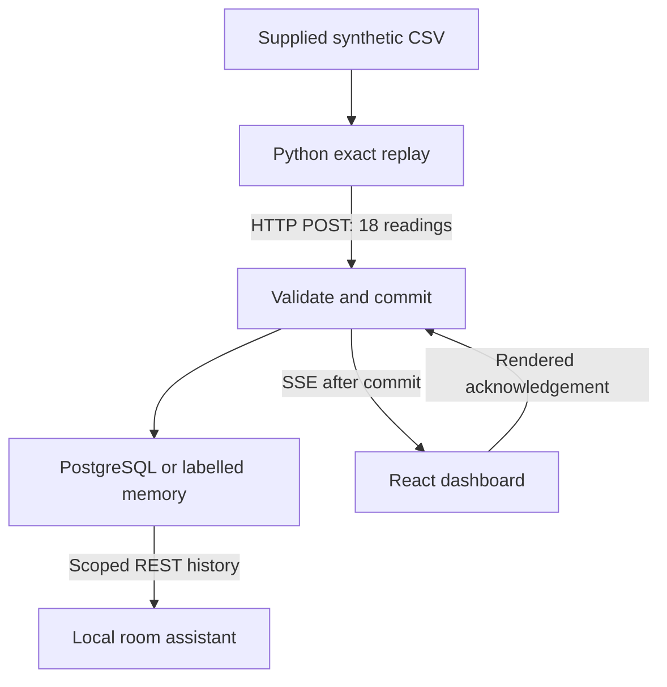

# Simulation-only synchronisation architecture

Research reviewed against current official documentation on 5 November 2026.

## Recommendation for this PoC

Use **persistent HTTP POST for Python ingestion, transactional storage, and server-sent
events (SSE) for browser updates**. REST remains useful for initial snapshots, history,
assistant requests and benchmark controls. No MQTT broker runs in this architecture.
Synthetic data can be carried by MQTT; simulated versus physical origin does not dictate
transport. The practical reasons for this choice are the team's MQTT constraint, only 18
points per batch, and a primarily one-way dashboard feed.

The supplied Tyra Lee Su Ee research report, *Evaluation of Real-Time Communication
Architectures for BIM-Based Digital Twin Synchronisation* (27 September 2026), separates
upstream ingestion, browser delivery and query traffic. That separation still applies.
Replace its proposed MQTT ingestion with HTTP POST, and its WebSocket push layer with
SSE. Remove BACnet/OPC UA/BMS interfaces from the implemented PoC diagram because no
physical feed is being integrated; show them only in a clearly separate future extension.
Do not reuse the report's literature latency numbers as this application's results.

## Current options and why this one fits

| Option | Relevant properties | Decision here |
| --- | --- | --- |
| HTTP POST + periodic browser polling | Simple, but polling adds a delay dependent on its interval and redundant snapshot requests | POST for ingestion; polling only status/metrics, not the primary reading feed |
| HTTP POST + SSE | Native EventSource; one-way text events, reconnection and event IDs; works over standard HTTP | Implemented; one atomic event per complete batch |
| HTTP POST + WebSocket | Persistent two-way communication without polling | Appropriate if future client controls need a continuous duplex channel; not required for passive telemetry |
| WebTransport / WebSocketStream | Additional transport/backpressure capabilities; deployment and support considerations | No demonstrated benefit for 18 low-rate readings; do not add just because they are newer |
| MQTT + WebSocket | Broker-mediated producers/subscribers, separate browser adapter | Viable with synthetic data, but excluded by team choice |

MDN describes SSE as a server-to-client channel and EventSource's reconnect/event-ID
mechanism [1]. It notes HTTP/1 connection limits, so use one shared stream per page and
HTTP/2 when deploying behind a compatible server/proxy. A local Express HTTP/1 demo is
sufficient for one visible tab, not a claim of large-client scalability. Disable proxy
buffering, flush events and send keepalives; test the actual deployment path.

MDN describes WebSocket's duplex operation and warns that the classic WebSocket API has
no automatic backpressure [2]. Neither transport name alone guarantees lower latency.
Compare with identical payloads, cadence, storage, hardware and visible-browser workload
if a defensible protocol ranking is required. This implementation is a workload-based
choice, not an experimental claim that SSE is faster than MQTT or WebSocket.

A useful current engineering direction is end-to-end observability: follow each batch,
measure tail latency and expose loss/recovery rather than reporting a single average.
OpenTelemetry standardizes HTTP span naming and attributes [3]. This app has lightweight
batch trace IDs and stage timestamps; an OpenTelemetry exporter is a possible next step,
**not** an installed component. No popularity or adoption-rate claim is implied.

## Reliability built into this implementation

- Validate exact sensor identity, room, type, unit, timestamp, completeness, binary values
  and finite numeric/missing values before writing. Preserve original values and times.
- Commit all 18 observations before emitting one browser event. A failed transaction
  publishes nothing. Memory mode is explicitly labelled and is not durable storage.
- Use a persistent HTTP connection, bounded retries, a stable batch ID and one in-flight
  request. Serialize API ingestion so concurrent duplicate requests cannot double-commit
  or double-broadcast within the current idempotency window.
- Cache 256 recent batch IDs and 128 SSE events. Reconnect with Last-Event-ID; expired
  cursors recover via a REST snapshot. Disconnect slow clients on socket backpressure
  so retained stream state stays bounded. This is not a durable delivery broker.
- Isolate history by replay session so a normal-data run cannot read future fault samples
  left from an earlier run. Do not run simultaneous publishers.
- Keep source labels and future features outside the live ingestion and assistant path.

For multiple API instances, durable replay/resume, or many publishers, replace in-process
buffers/state with a shared durable log and explicit tenancy/session routing. Add a broker
only when those measured requirements justify it; the current app is a single-API PoC.

## What the five-second requirement means

Dataset time and processing time are different clocks. These observations are five minutes
apart. Releasing them every two seconds accelerates replay by 150×; it does not create
five-second source sampling or prove the freshness of a real building feed.

For this simulator define the source boundary as the instant a validated historical batch
is released for delivery. Stamp `generated_at_utc` then; never subtract a January 2026
observation timestamp from today's browser clock. Capture:

1. Source release.
2. API receipt, before ingestion queue/validation.
3. Complete storage commit.
4. React receives the complete batch and commits state.
5. Two requestAnimationFrame callbacks, then acknowledgement received by the API.

Steps 1–3 use the same host clock in the default local configuration. Steps 4–5 avoid
subtracting browser and server clocks. The reported end-to-end result includes the return
HTTP hop and a browser paint opportunity, making it a **conservative upper bound**. It is
not proof of GPU completion or exact pixel visibility. Background tabs are not valid trials.
If the producer is remote, synchronized clocks and measured clock uncertainty are required;
`unsynchronized_remote` disables the source-to-twin claim rather than fabricating a number.

Use **Simulator → Start new measurement run**, keep one tab visible, then download the
results after at least 30 complete batches. Report count, missing acknowledgements,
median, p95, maximum and proportion ≤5,000 ms; include storage, hardware, browser,
release cadence, model rendering load and concurrent-client count. All batches must be
accounted for. A low median with a high p95 does not establish an every-update target.
Include slower machines, persistent storage, reconnects and concurrent UI/assistant work
before claiming acceptance. AI response/inference time is a separate benchmark.

The preview environment lacks WebGL 2 and local Ollama. Any preview results cover the
sensor UI with temporary memory, not a loaded 3D model, a real PostgreSQL deployment,
the final Mac, or AI contention. The older non-dataset trial in `docs/benchmarks/` remains
historical evidence; it is not the new replay's result.

## References

1. MDN. Using server-sent events. https://developer.mozilla.org/en-US/docs/Web/API/Server-sent_events/Using_server-sent_events (accessed 2026-11-05).
2. MDN. WebSocket API. https://developer.mozilla.org/en-US/docs/Web/API/WebSockets_API (accessed 2026-11-05).
3. OpenTelemetry. Semantic conventions for HTTP spans. https://opentelemetry.io/docs/specs/semconv/http/http-spans/ (accessed 2026-11-05).
4. WHATWG HTML. Server-sent events. https://html.spec.whatwg.org/dev/server-sent-events.html (reviewed during architecture research).

## Observed dataset replay preview trial

A browser trial at two-second release cadence recorded 105 batches: 102 acknowledged,
three without browser acknowledgements at capture. Among acknowledged batches, median
was **1,450 ms**, p95 **1,954 ms**, maximum **2,000 ms**, and 102/102 were below 5,000 ms.
The automatic assessment correctly remained **incomplete**. These percentiles describe
acknowledged batches only and cannot establish the every-update target. The timing includes
the cloud-browser route and acknowledgement return hop. See the
[observed summary](benchmarks/2026-11-05-dataset-replay-summary.json). The summary is not
a raw-sample export. This environment did not exercise WebGL rendering or Ollama.

## Recent research directions and their practical use here

The following distinction is based on published abstracts/current primary-source pages;
no performance number from these papers is transferred to this application.

| Research | Direction | Application to this project |
| --- | --- | --- |
| Loubany, Itani & Sharafeddine (2025), IEEE Access, DOI 10.1109/ACCESS.2025.3591589 | Reviews synchronization metrics and proposes Age of Digital Twin alongside information freshness | Report source sampling interval/freshness separately from processing latency; fast replay does not imply fresh physical observations |
| Freitas et al. (2026), arXiv:2601.23051, preprint | Proposes a data-centric synchronization architecture addressing interoperability and security | Keep telemetry validation, storage, analysis and presentation boundaries explicit rather than calling a transport protocol the entire architecture |
| Farag & Stefanovic (2026), arXiv:2604.00566, preprint | Studies edge placement and update scheduling using information freshness and update cost; reported findings are simulation results | Keep the producer and API local for a controlled baseline and investigate measured bottlenecks; do not add its reinforcement-learning policy to an 18-point replay without evidence of need |

These works concern broader IoT/edge settings and do not establish that HTTP/SSE is the
fastest protocol for this building PoC. The specific HTTP/SSE choice remains an engineering
inference from the team's constraint and the actual workload. An assessment of this code
requires its own measurements, including missing updates and slow-client recovery.

Primary sources:

- https://ieeexplore.ieee.org/document/11088075/ (published 22 July 2025).
- https://arxiv.org/abs/2601.23051 (submitted 30 January 2026; preprint).
- https://arxiv.org/abs/2604.00566 (submitted 1 April 2026; preprint).
